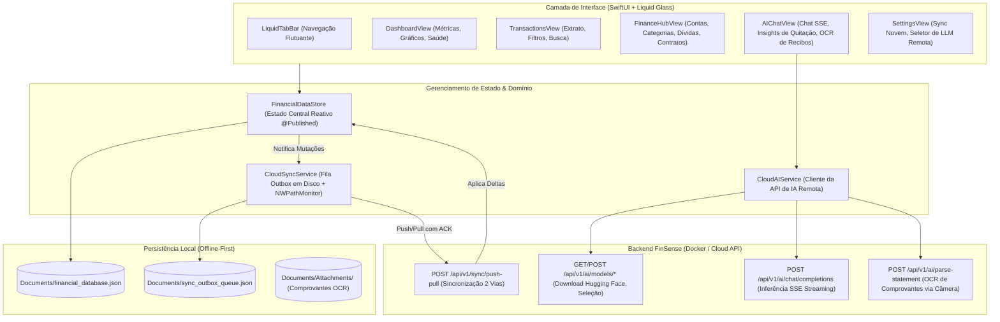

# Especificação de Engenharia de Software: FinSense iOS (Agent-First)

> **Documento Canônico de Especificação Técnica e Implementação para Agentes Autônomos**  
> **Target:** AI Coding Agents, iOS Engineers & Mobile Architects  
> **Nome do Projeto:** `FinSense-ios`  
> **Caminho Canônico do Repositório:** `/Users/clovis/projetos/FinSense-ios`  
> **Versão da Especificação:** 1.0.0  
> **Data de Emissão:** 2026-11-08  
> **Backend de Referência:** [BACKEND_SPECIFICATION.md](file:///Users/clovis/projetos/FinSense/BACKEND_SPECIFICATION.md) (v2.1.0)  
> **Plataformas Alvo:** iOS 17.0+ / iPadOS 17.0+ (SwiftUI 5+ / Swift 5.9+)  
> **Identidade Visual:** *Modern Liquid Glass & Glassmorphism System (transparências, materiais ultra-finos, reflexos especulares e micro-interações táteis).*

---

## 1. Manifesto de Arquitetura & Diretrizes para Agentes

```yaml
system_manifest:
  app_name: "FinSense"
  bundle_id: "br.com.finsense.ios"
  platform: "iOS 17.0+ / iPadOS 17.0+"
  language: "Swift 5.9+"
  ui_framework: "SwiftUI nativo com Human Interface Guidelines (HIG)"
  design_system: "Liquid Glass (Materiais .ultraThinMaterial, bordas especulares, sombras de profundidade e feedback háptico)"
  architecture: "Offline-First MVVM + Repository Pattern + Observable Data Store"
  backend_api_base_url_local: "http://localhost:8080/api/v1 (Simulador) ou http://<MAC_LAN_IP>:8080/api/v1 (Dispositivo Físico)"
  backend_api_base_url_production: "https://api.finsense.com.br/v1"
  persistence_local: "JSON Snapshot Atômico (DocumentsDirectory/financial_database.json) + Outbox Persistente"
  sync_protocol: "Two-Way Push/Pull Monotonic Revision com Last-Write-Wins (LWW) via POST /api/v1/sync/push-pull"
  ai_execution_model: "100% Remoto no Backend via API (/api/v1/ai/*) com suporte a SSE Streaming, OCR Multimodal e Gestão de Modelos Hugging Face"

agent_execution_rules:
  rule_01_offline_first: "Toda mutação local (criar transação, editar saldo, dar baixa em cota, amortizar empréstimo) DEVE ser persistida em disco localmente em menos de 10ms antes de qualquer tentativa de rede."
  rule_02_zero_blocking: "A thread principal (Main Thread) NUNCA pode ser bloqueada aguardando rede. Falhas de conexão, timeouts ou servidores offline não devem disparar modais intrusivos de erro."
  rule_03_scope_exclusion: "O app iOS NÃO DEVE possuir funcionalidade de importação e exportação de arquivos de base de dados JSON. O intercâmbio de dados é realizado exclusivamente via sincronização em nuvem."
  rule_04_liquid_glass_design: "Todos os cards, headers, barras de navegação e controles devem adotar o design Liquid Glass com esquinas squircle contínuas, materiais translucentes e destaques especulares."
  rule_05_haptic_feedback: "Toda ação de sucesso, troca de abas, toque em botões e confirmações de pagamento deve disparar feedback sensorial correspondente via UIImpactFeedbackGenerator / UINotificationFeedbackGenerator."
  rule_06_exact_duplicates: "Transações manuais com mesma data, descrição e valor possuem UUIDs distintos e NUNCA devem ser agrupadas ou descartadas pelo cliente ou backend."
```

---

## 2. Diagrama de Arquitetura do Cliente iOS



---

## 3. Design System: Modern Liquid Glass para iOS

O design **Liquid Glass** traz a elegância tátil do iOS, combinando a profundidade do vidro translúcido fosco com reflexos dinâmicos e cores financeiras vibrantes.

### 3.1. Paleta de Cores e Tokens Semânticos

| Token Semântico | Hex (Light Mode) | Hex (Dark Mode) | Aplicação |
| :--- | :--- | :--- | :--- |
| `liquidBackground` | `#F1F5F9` | `#0B0F17` | Fundo principal da aplicação |
| `liquidSurfaceGlass` | `Color.white.opacity(0.65)` | `Color(hex: "#1E293B").opacity(0.55)` | Material base para cards e modais |
| `liquidBorderSpecular` | `Color.white.opacity(0.85)` | `Color.white.opacity(0.18)` | Contorno especular com gradiente |
| `financialIncome` | `#059669` (Esmeralda) | `#10B981` (Menta Vibrante) | Receitas, fluxo positivo e metas atingidas |
| `financialExpense` | `#DC2626` (Rubi) | `#F43F5E` (Rosa Carmim) | Despesas, saídas e contas a pagar |
| `financialPending` | `#D97706` (Âmbar) | `#F59E0B` (Dourado) | Transações pendentes e provisões |
| `financialInvestment`| `#4F46E5` (Índigo) | `#818CF8` (Violeta) | Aportes, carteira e patrimônio |
| `financialAI` | `#0284C7` (Ciano) | `#38BDF8` (Azul Elétrico) | Destaques da IA, diagnósticos e streaming |

### 3.2. Modificadores e Componentes Visuais Reutilizáveis

O agente deve implementar as extensões SwiftUI abaixo para padronizar o visual em todo o app:

```swift
// Sources/FinSense/DesignSystem/LiquidGlassModifiers.swift
import SwiftUI

public struct LiquidGlassCardModifier: ViewModifier {
    @Environment(\.colorScheme) var colorScheme
    public var cornerRadius: CGFloat
    public var padding: CGFloat

    public init(cornerRadius: CGFloat = 22, padding: CGFloat = 16) {
        self.cornerRadius = cornerRadius
        self.padding = padding
    }

    public var body(content: Content) -> some View {
        content
            .padding(padding)
            .background(
                RoundedRectangle(cornerRadius: cornerRadius, style: .continuous)
                    .fill(.ultraThinMaterial)
            )
            .overlay(
                RoundedRectangle(cornerRadius: cornerRadius, style: .continuous)
                    .stroke(
                        LinearGradient(
                            stops: [
                                .init(color: colorScheme == .dark ? Color.white.opacity(0.25) : Color.white.opacity(0.8), location: 0.0),
                                .init(color: colorScheme == .dark ? Color.white.opacity(0.05) : Color.white.opacity(0.2), location: 0.6),
                                .init(color: colorScheme == .dark ? Color.white.opacity(0.15) : Color.white.opacity(0.5), location: 1.0)
                            ],
                            startPoint: .topLeading,
                            endPoint: .bottomTrailing
                        ),
                        lineWidth: 1.2
                    )
            )
            .shadow(
                color: colorScheme == .dark ? Color.black.opacity(0.4) : Color.black.opacity(0.06),
                radius: 16,
                x: 0,
                y: 8
            )
    }
}

public extension View {
    func liquidGlassCard(cornerRadius: CGFloat = 22, padding: CGFloat = 16) -> some View {
        self.modifier(LiquidGlassCardModifier(cornerRadius: cornerRadius, padding: padding))
    }
}

// Componente de Cartão Liquid Glass Reutilizável
public struct LiquidGlassCard<Content: View>: View {
    private let cornerRadius: CGFloat
    private let padding: CGFloat
    private let content: Content

    public init(
        cornerRadius: CGFloat = 22,
        padding: CGFloat = 16,
        @ViewBuilder content: () -> Content
    ) {
        self.cornerRadius = cornerRadius
        self.padding = padding
        self.content = content()
    }

    public var body: some View {
        content
            .liquidGlassCard(cornerRadius: cornerRadius, padding: padding)
    }
}
```

### 3.3. Barra de Navegação Flutuante (`LiquidTabBar.swift`)

A barra de abas inferior deve flutuar acima do conteúdo com visual de cápsula envidraçada:

```swift
// Sources/FinSense/Views/Navigation/LiquidTabBar.swift
import SwiftUI

public enum AppTab: Int, CaseIterable, Identifiable {
    case dashboard = 0
    case transactions = 1
    case financeHub = 2
    case aiChat = 3
    case settings = 4

    public var id: Int { rawValue }

    public var title: String {
        switch self {
        case .dashboard: return "Início"
        case .transactions: return "Extrato"
        case .financeHub: return "Finanças"
        case .aiChat: return "FinSense AI"
        case .settings: return "Ajustes"
        }
    }

    public var iconSymbol: String {
        switch self {
        case .dashboard: return "chart.pie.fill"
        case .transactions: return "list.bullet.rectangle.portrait.fill"
        case .financeHub: return "building.columns.fill"
        case .aiChat: return "sparkles"
        case .settings: return "gearshape.fill"
        }
    }
}

public struct LiquidTabBar: View {
    @Binding public var selectedTab: AppTab
    @Namespace private var animationNamespace

    public var body: some View {
        HStack(spacing: 8) {
            ForEach(AppTab.allCases) { tab in
                Button {
                    UIImpactFeedbackGenerator(style: .light).impactOccurred()
                    withAnimation(.spring(response: 0.35, dampingFraction: 0.72)) {
                        selectedTab = tab
                    }
                } label: {
                    VStack(spacing: 4) {
                        Image(systemName: tab.iconSymbol)
                            .font(.system(size: 19, weight: selectedTab == tab ? .bold : .medium))
                            .foregroundStyle(selectedTab == tab ? Color(hex: "#0284C7") : Color.secondary)
                            .scaleEffect(selectedTab == tab ? 1.12 : 1.0)

                        Text(tab.title)
                            .font(.system(size: 10, weight: selectedTab == tab ? .semibold : .regular))
                            .foregroundStyle(selectedTab == tab ? Color.primary : Color.secondary)
                    }
                    .frame(maxWidth: .infinity)
                    .padding(.vertical, 8)
                    .background {
                        if selectedTab == tab {
                            Capsule()
                                .fill(Color(hex: "#0284C7").opacity(0.12))
                                .matchedGeometryEffect(id: "ACTIVE_TAB_PILL", in: animationNamespace)
                        }
                    }
                }
                .buttonStyle(.plain)
            }
        }
        .padding(.horizontal, 10)
        .padding(.vertical, 6)
        .background(
            Capsule()
                .fill(.ultraThinMaterial)
                .overlay(
                    Capsule()
                        .stroke(Color.white.opacity(0.3), lineWidth: 1)
                )
                .shadow(color: Color.black.opacity(0.12), radius: 20, x: 0, y: 10)
        )
        .padding(.horizontal, 16)
        .padding(.bottom, 6)
    }
}
```

---

## 4. Estrutura de Arquivos do Projeto iOS (`Sources/FinSense/`)

O agente deve estruturar o código do app iOS na seguinte árvore:

```
Sources/FinSense/
├── App/
│   ├── FinSenseApp.swift                       <-- Ponto de entrada SwiftUI (@main)
│   └── ContentView.swift                       <-- Orquestrador de tabs e overlays
├── DesignSystem/
│   ├── LiquidGlassModifiers.swift              <-- Modificadores de vidro, bordas e sombras
│   ├── ColorTokens.swift                       <-- Paleta semântica e gradientes
│   └── Formatters.swift                        <-- Formatadores BRL, datas e taxas
├── Models/
│   ├── BankAccount.swift                       <-- Conta corrente, poupança, cartão
│   ├── CategoryItem.swift                      <-- Categorias com tipo, ícone e cor
│   ├── FinancialTransaction.swift              <-- Transações com recorrência e anexos
│   ├── InvestmentItem.swift                    <-- Ativos e movimentações
│   ├── DebtItem.swift                          <-- Dívidas e acordos negociados
│   ├── CreditContract.swift                    <-- Financiamentos, SAC/Price e amortização
│   ├── CategoryProvision.swift                 <-- Metas e provisões mensais
│   ├── CategoryQuotaRule.swift                 <-- Tetos e cotas de categorias
│   ├── ChatMessage.swift                       <-- Mensagens e histórico do chat de IA
│   ├── CloudSyncModels.swift                   <-- DTOs de mutação, push/pull e status
│   └── CloudAIModels.swift                     <-- DTOs da API remota de IA e OCR
├── Services/
│   ├── FinancialDataStore.swift                <-- Estado central local reativo (@Published)
│   ├── CloudSyncService.swift                  <-- Motor de sincronização 2 vias e outbox
│   ├── CloudAIService.swift                    <-- Cliente de IA remota (Chat SSE, OCR, Hugging Face)
│   └── BackendAPIClient.swift                  <-- Cliente HTTP genérico com URLSession
└── Views/
    ├── Navigation/
    │   ├── LiquidTabBar.swift                  <-- Barra de abas flutuante
    │   └── LiquidNavigationBar.swift           <-- Topo com status de sync e botão rápido
    ├── Dashboard/
    │   ├── DashboardView.swift                 <-- Tela principal com score de saúde e fluxo
    │   ├── FinancialHealthCard.swift           <-- Card circular de diagnóstico financeiro
    │   ├── AccountsCarouselView.swift          <-- Carrossel horizontal de contas e saldos
    │   └── MonthlyCashFlowCard.swift           <-- Gráfico de barras de fluxo mensal
    ├── Transactions/
    │   ├── TransactionsListView.swift          <-- Lista agrupada por dia com swipe actions
    │   ├── TransactionDetailSheet.swift        <-- Formulário de criação/edição
    │   └── ReceiptCameraScannerView.swift      <-- Captura de recibo via câmera com OCR
    ├── FinanceHub/
    │   ├── FinanceHubMainView.swift            <-- Hub central de módulos financeiros
    │   ├── AccountsManagerView.swift           <-- Gestão de contas bancárias
    │   ├── CategoriesManagerView.swift         <-- Gestão de categorias
    │   ├── InvestmentsManagerView.swift        <-- Gestão de carteira de investimentos
    │   ├── DebtsManagerView.swift              <-- Gestão de dívidas e quitações
    │   ├── CreditContractsView.swift           <-- Financiamentos e amortização extraordinária
    │   ├── ProvisionsView.swift                <-- Metas de reserva
    │   └── CategoryQuotasView.swift            <-- Cotas de categoria e resgate em transação
    ├── AIChat/
    │   ├── AIChatMainView.swift                <-- Chat interativo com streaming SSE
    │   ├── ModelSelectorSheet.swift            <-- Seletor de modelo remoto na nuvem
    │   └── AISuggestionPillView.swift          <-- Botões de prompts contextuais rápidos
    └── Settings/
        ├── SettingsMainView.swift              <-- Configurações gerais
        ├── CloudSyncSettingsView.swift         <-- Configurações do backend e disparo manual
        └── RemoteAIManagementView.swift        <-- Download do Hugging Face e seleção de LLM
```

---

## 5. Especificação dos Modelos de Dados Nativos iOS

Os modelos de dados no iOS compartilham a mesma tipagem e esquemas do macOS e do backend para garantir compatibilidade bidirecional perfeita via JSON.

### 5.1. DTOs de Sincronização e Estado da Fila (`CloudSyncModels.swift`)

```swift
// Sources/FinSense/Models/CloudSyncModels.swift
import Foundation

public enum SyncStatus: Equatable {
    case disabled
    case synced(lastSync: Date)
    case syncing
    case outOfSync(pendingCount: Int, reason: String)
    case authError(message: String)

    public var iconSymbol: String {
        switch self {
        case .disabled: return "icloud"
        case .synced: return "checkmark.icloud.fill"
        case .syncing: return "arrow.triangle.2.circlepath.icloud.fill"
        case .outOfSync: return "exclamationmark.icloud.fill"
        case .authError: return "xmark.icloud.fill"
        }
    }
}

public enum SyncOperation: String, Codable {
    case upsert = "UPSERT"
    case delete = "DELETE"
}

public struct LocalSyncMutation: Identifiable, Codable, Hashable {
    public var id: UUID
    public var entityName: String
    public var entityId: UUID
    public var operation: SyncOperation
    public var updatedAt: Date
    public var payloadJSON: String?

    public init(
        id: UUID = UUID(),
        entityName: String,
        entityId: UUID,
        operation: SyncOperation,
        updatedAt: Date = Date(),
        payloadJSON: String? = nil
    ) {
        self.id = id
        self.entityName = entityName
        self.entityId = entityId
        self.operation = operation
        self.updatedAt = updatedAt
        self.payloadJSON = payloadJSON
    }
}

public struct SyncPushPullRequest: Codable {
    public let clientId: String
    public let clientLastSyncRevision: Int64
    public let mutations: [SyncMutationDTO]

    enum CodingKeys: String, CodingKey {
        case clientId = "client_id"
        case clientLastSyncRevision = "client_last_sync_revision"
        case mutations
    }
}

public struct SyncMutationDTO: Codable {
    public let mutationId: UUID
    public let entityName: String
    public let entityId: UUID
    public let operation: String
    public let updatedAt: String
    public let payload: [String: AnyCodableValue]?

    enum CodingKeys: String, CodingKey {
        case mutationId = "mutation_id"
        case entityName = "entity_name"
        case entityId = "entity_id"
        case operation
        case updatedAt = "updated_at"
        case payload
    }
}

public struct SyncPushPullResponse: Codable {
    public let serverCurrentRevision: Int64
    public let acknowledgedMutationIds: [UUID]
    public let rejectedMutations: [SyncRejectedMutationDTO]
    public let deltas: SyncDeltasContainerDTO
    public let tombstones: [SyncTombstoneDTO]

    enum CodingKeys: String, CodingKey {
        case serverCurrentRevision = "server_current_revision"
        case acknowledgedMutationIds = "acknowledged_mutation_ids"
        case rejectedMutations = "rejected_mutations"
        case deltas
        case tombstones
    }
}

public struct SyncRejectedMutationDTO: Codable {
    public let mutationId: UUID
    public let reason: String
}

public struct SyncTombstoneDTO: Codable {
    public let entityName: String
    public let entityId: UUID
    public let deletedAt: String

    enum CodingKeys: String, CodingKey {
        case entityName = "entity_name"
        case entityId = "entity_id"
        case deletedAt = "deleted_at"
    }
}

public struct SyncDeltasContainerDTO: Codable {
    public let bankAccounts: [BankAccount]?
    public let categories: [CategoryItem]?
    public let financialTransactions: [FinancialTransaction]?
    public let investmentItems: [InvestmentItem]?
    public let creditContracts: [CreditContract]?
    public let debtItems: [DebtItem]?
    public let categoryProvisions: [CategoryProvision]?
    public let categoryQuotaRules: [CategoryQuotaRule]?
    public let chatMessages: [ChatMessage]?

    enum CodingKeys: String, CodingKey {
        case bankAccounts = "bank_accounts"
        case categories
        case financialTransactions = "financial_transactions"
        case investmentItems = "investment_items"
        case creditContracts = "credit_contracts"
        case debtItems = "debt_items"
        case categoryProvisions = "category_provisions"
        case categoryQuotaRules = "category_quota_rules"
        case chatMessages = "chat_messages"
    }
}

public enum AnyCodableValue: Codable, Hashable {
    case string(String)
    case int(Int)
    case double(Double)
    case bool(Bool)
    case dictionary([String: AnyCodableValue])
    case array([AnyCodableValue])
    case null

    public init(from decoder: Decoder) throws {
        let container = try decoder.singleValueContainer()
        if container.decodeNil() { self = .null }
        else if let b = try? container.decode(Bool.self) { self = .bool(b) }
        else if let i = try? container.decode(Int.self) { self = .int(i) }
        else if let d = try? container.decode(Double.self) { self = .double(d) }
        else if let s = try? container.decode(String.self) { self = .string(s) }
        else if let arr = try? container.decode([AnyCodableValue].self) { self = .array(arr) }
        else if let dict = try? container.decode([String: AnyCodableValue].self) { self = .dictionary(dict) }
        else { self = .null }
    }

    public func encode(to encoder: Encoder) throws {
        var container = encoder.singleValueContainer()
        switch self {
        case .string(let s): try container.encode(s)
        case .int(let i): try container.encode(i)
        case .double(let d): try container.encode(d)
        case .bool(let b): try container.encode(b)
        case .dictionary(let dict): try container.encode(dict)
        case .array(let arr): try container.encode(arr)
        case .null: try container.encodeNil()
        }
    }
}
```

### 5.2. DTOs de IA no Backend (`CloudAIModels.swift`)

```swift
// Sources/FinSense/Models/CloudAIModels.swift
import Foundation

public struct BackendAIModelInfo: Identifiable, Codable, Hashable {
    public let id: String
    public let displayName: String
    public let repoId: String
    public let fileName: String
    public let sizeBytes: Int64
    public let quantization: String
    public let isActive: Bool

    enum CodingKeys: String, CodingKey {
        case id
        case displayName = "display_name"
        case repoId = "repo_id"
        case fileName = "file_name"
        case sizeBytes = "size_bytes"
        case quantization
        case isActive = "is_active"
    }
}

public struct SuggestedBackendModel: Identifiable, Codable, Hashable {
    public let id: String
    public let name: String
    public let description: String
    public let sizeEstimate: String
    public let isDownloaded: Bool

    enum CodingKeys: String, CodingKey {
        case id, name, description
        case sizeEstimate = "size_estimate"
        case isDownloaded = "is_downloaded"
    }
}

public struct AIModelsCatalogResponse: Codable {
    public let selectedModelId: String?
    public let installedModels: [BackendAIModelInfo]
    public let suggestedModels: [SuggestedBackendModel]

    enum CodingKeys: String, CodingKey {
        case selectedModelId = "selected_model_id"
        case installedModels = "installed_models"
        case suggestedModels = "suggested_models"
    }
}

public struct AIDownloadTaskStatusResponse: Codable {
    public let taskId: UUID
    public let repoId: String
    public let fileName: String
    public let status: String // "PENDING", "DOWNLOADING", "VERIFYING", "READY", "FAILED", "CANCELED"
    public let progressPercentage: Double
    public let downloadedBytes: Int64
    public let totalBytes: Int64
    public let speedBytesSec: Int64
    public let errorMessage: String?

    enum CodingKeys: String, CodingKey {
        case taskId = "task_id"
        case repoId = "repo_id"
        case fileName = "file_name"
        case status
        case progressPercentage = "progress_percentage"
        case downloadedBytes = "downloaded_bytes"
        case totalBytes = "total_bytes"
        case speedBytesSec = "speed_bytes_sec"
        case errorMessage = "error_message"
    }
}

public struct AIStatementParseResponse: Codable {
    public let transactions: [ParsedTransactionDTO]
    public let rawText: String?
    public let processingTimeMs: Int

    enum CodingKeys: String, CodingKey {
        case transactions
        case rawText = "raw_text"
        case processingTimeMs = "processing_time_ms"
    }
}

public struct ParsedTransactionDTO: Codable, Identifiable {
    public var id: UUID { UUID() }
    public let date: String
    public let description: String
    public let amount: Double
    public let type: String
    public let categorySuggestion: String?

    enum CodingKeys: String, CodingKey {
        case date, description, amount, type
        case categorySuggestion = "category_suggestion"
    }
}
```

---

## 6. Implementação dos Serviços Nativos no iOS

### 6.1. Motor de Sincronização Local (`CloudSyncService.swift`)

O `CloudSyncService` opera em segundo plano no iOS, gerenciando a outbox em `Documents/sync_outbox_queue.json` e integrando com o `NWPathMonitor`:

```swift
// Sources/FinSense/Services/CloudSyncService.swift
import Foundation
import Combine
import Network
import SwiftUI

@MainActor
public final class CloudSyncService: ObservableObject {
    @Published public var syncStatus: SyncStatus = .disabled
    @Published public var isSyncing: Bool = false
    @Published public var pendingMutationsCount: Int = 0
    @Published public var lastSyncDate: Date? = nil

    @AppStorage("cloud_sync_enabled") public var isEnabled: Bool = false
    @AppStorage("cloud_sync_base_url") public var baseURLString: String = "http://localhost:8080/api/v1"
    @AppStorage("cloud_sync_client_id") public var clientId: String = UUID().uuidString
    @AppStorage("cloud_sync_last_revision") public var lastServerRevision: Int64 = 0

    private var outboxQueue: [LocalSyncMutation] = []
    private let outboxFileURL: URL
    private var debounceTimer: AnyCancellable? = nil
    private let networkMonitor = NWPathMonitor()
    private var isNetworkAvailable: Bool = true
    private weak var store: FinancialDataStore?

    public init(store: FinancialDataStore) {
        self.store = store
        let docs = FileManager.default.urls(for: .documentDirectory, in: .userDomainMask).first!
        self.outboxFileURL = docs.appendingPathComponent("sync_outbox_queue.json")
        loadOutboxQueue()
        startNetworkMonitoring()
        evaluateInitialStatus()
    }

    private func evaluateInitialStatus() {
        if !isEnabled {
            syncStatus = .disabled
        } else if !outboxQueue.isEmpty {
            syncStatus = .outOfSync(pendingCount: outboxQueue.count, reason: "Alterações pendentes")
        } else if let last = lastSyncDate {
            syncStatus = .synced(lastSync: last)
        } else {
            syncStatus = .synced(lastSync: Date())
        }
    }

    private func startNetworkMonitoring() {
        networkMonitor.pathUpdateHandler = { [weak self] path in
            Task { @MainActor in
                guard let self else { return }
                self.isNetworkAvailable = (path.status == .satisfied)
                if self.isNetworkAvailable && self.isEnabled {
                    self.scheduleSync(delaySeconds: 1.0)
                } else if !self.isNetworkAvailable && self.isEnabled {
                    self.syncStatus = .outOfSync(
                        pendingCount: self.outboxQueue.count,
                        reason: "Sem conexão com a internet"
                    )
                }
            }
        }
        let queue = DispatchQueue(label: "br.com.finsense.ios.syncNetworkMonitor")
        networkMonitor.start(queue: queue)
    }

    public func recordLocalMutation<T: Codable>(
        entityName: String,
        entityId: UUID,
        operation: SyncOperation,
        entity: T? = nil
    ) {
        guard isEnabled else { return }

        let payloadJSON: String? = {
            guard let entity, operation == .upsert,
                  let data = try? JSONEncoder().encode(entity),
                  let str = String(data: data, encoding: .utf8) else { return nil }
            return str
        }()

        let mutation = LocalSyncMutation(
            entityName: entityName,
            entityId: entityId,
            operation: operation,
            updatedAt: Date(),
            payloadJSON: payloadJSON
        )

        outboxQueue.append(mutation)
        saveOutboxQueue()
        pendingMutationsCount = outboxQueue.count
        syncStatus = .outOfSync(pendingCount: outboxQueue.count, reason: "Alterações pendentes")
        scheduleSync(delaySeconds: 2.5)
    }

    private func scheduleSync(delaySeconds: Double) {
        guard isEnabled, isNetworkAvailable else { return }
        debounceTimer?.cancel()
        debounceTimer = Just(())
            .delay(for: .seconds(delaySeconds), scheduler: RunLoop.main)
            .sink { [weak self] in
                self?.performSync()
            }
    }

    public func performSync() {
        guard isEnabled else { syncStatus = .disabled; return }
        guard isNetworkAvailable else {
            syncStatus = .outOfSync(pendingCount: outboxQueue.count, reason: "Sem internet")
            return
        }
        guard !isSyncing else { return }

        isSyncing = true
        syncStatus = .syncing

        Task {
            await executeSyncPushPull()
        }
    }

    private func executeSyncPushPull() async {
        guard let store else { isSyncing = false; return }

        let batchToSend = Array(outboxQueue.prefix(250))
        let payload = SyncPushPullRequest(
            clientId: clientId,
            clientLastSyncRevision: lastServerRevision,
            mutations: batchToSend.map { mut in
                SyncMutationDTO(
                    mutationId: mut.id,
                    entityName: mut.entityName,
                    entityId: mut.entityId,
                    operation: mut.operation.rawValue,
                    updatedAt: ISO8601DateFormatter().string(from: mut.updatedAt),
                    payload: mut.payloadJSON.flatMap { try? JSONDecoder().decode([String: AnyCodableValue].self, from: Data($0.utf8)) }
                )
            }
        )

        do {
            let response = try await BackendAPIClient.shared.pushPull(
                baseURL: baseURLString,
                requestPayload: payload
            )

            let ackSet = Set(response.acknowledgedMutationIds)
            outboxQueue.removeAll { ackSet.contains($0.id) }
            saveOutboxQueue()
            pendingMutationsCount = outboxQueue.count

            applyDeltasToStore(response.deltas, tombstones: response.tombstones, into: store)

            lastServerRevision = response.serverCurrentRevision
            let now = Date()
            lastSyncDate = now

            if outboxQueue.isEmpty {
                syncStatus = .synced(lastSync: now)
                UINotificationFeedbackGenerator().notificationOccurred(.success)
            } else {
                syncStatus = .outOfSync(pendingCount: outboxQueue.count, reason: "Sincronizando lote seguinte...")
                scheduleSync(delaySeconds: 0.5)
            }
        } catch {
            // Servidor fora do ar: Degradação suave sem travar o app
            syncStatus = .outOfSync(pendingCount: outboxQueue.count, reason: "Servidor indisponível")
        }

        isSyncing = false
    }

    private func applyDeltasToStore(
        _ deltas: SyncDeltasContainerDTO,
        tombstones: [SyncTombstoneDTO],
        into store: FinancialDataStore
    ) {
        for tomb in tombstones {
            switch tomb.entityName {
            case "financial_transactions": store.transactions.removeAll { $0.id == tomb.entityId }
            case "bank_accounts": store.accounts.removeAll { $0.id == tomb.entityId }
            case "categories": store.categories.removeAll { $0.id == tomb.entityId }
            case "investment_items": store.investments.removeAll { $0.id == tomb.entityId }
            case "debt_items": store.debts.removeAll { $0.id == tomb.entityId }
            case "credit_contracts": store.contracts.removeAll { $0.id == tomb.entityId }
            case "category_provisions": store.provisions.removeAll { $0.id == tomb.entityId }
            case "category_quota_rules": store.categoryQuotas.removeAll { $0.id == tomb.entityId }
            default: break
            }
        }

        if let txs = deltas.financialTransactions {
            for item in txs {
                if let idx = store.transactions.firstIndex(where: { $0.id == item.id }) {
                    store.transactions[idx] = item
                } else {
                    store.transactions.append(item)
                }
            }
        }
        if let accs = deltas.bankAccounts {
            for item in accs {
                if let idx = store.accounts.firstIndex(where: { $0.id == item.id }) {
                    store.accounts[idx] = item
                } else {
                    store.accounts.append(item)
                }
            }
        }
        if let cats = deltas.categories {
            for item in cats {
                if let idx = store.categories.firstIndex(where: { $0.id == item.id }) {
                    store.categories[idx] = item
                } else {
                    store.categories.append(item)
                }
            }
        }
        if let invs = deltas.investmentItems {
            for item in invs {
                if let idx = store.investments.firstIndex(where: { $0.id == item.id }) {
                    store.investments[idx] = item
                } else {
                    store.investments.append(item)
                }
            }
        }
        if let debts = deltas.debtItems {
            for item in debts {
                if let idx = store.debts.firstIndex(where: { $0.id == item.id }) {
                    store.debts[idx] = item
                } else {
                    store.debts.append(item)
                }
            }
        }
        if let contracts = deltas.creditContracts {
            for item in contracts {
                if let idx = store.contracts.firstIndex(where: { $0.id == item.id }) {
                    store.contracts[idx] = item
                } else {
                    store.contracts.append(item)
                }
            }
        }
        if let provisions = deltas.categoryProvisions {
            for item in provisions {
                if let idx = store.provisions.firstIndex(where: { $0.id == item.id }) {
                    store.provisions[idx] = item
                } else {
                    store.provisions.append(item)
                }
            }
        }
        if let quotas = deltas.categoryQuotaRules {
            for item in quotas {
                if let idx = store.categoryQuotas.firstIndex(where: { $0.id == item.id }) {
                    store.categoryQuotas[idx] = item
                } else {
                    store.categoryQuotas.append(item)
                }
            }
        }

        store.save()
    }

    private func saveOutboxQueue() {
        guard let data = try? JSONEncoder().encode(outboxQueue) else { return }
        try? data.write(to: outboxFileURL, options: .atomic)
    }

    private func loadOutboxQueue() {
        guard let data = try? Data(contentsOf: outboxFileURL),
              let decoded = try? JSONDecoder().decode([LocalSyncMutation].self, from: data) else {
            self.outboxQueue = []
            return
        }
        self.outboxQueue = decoded
        self.pendingMutationsCount = decoded.count
    }
}
```

---

### 6.2. Cliente de IA Remota no Backend (`CloudAIService.swift`)

No iOS, as operações de IA são 100% delegadas para a API do backend:

```swift
// Sources/FinSense/Services/CloudAIService.swift
import Foundation
import UIKit

@MainActor
public final class CloudAIService: ObservableObject {
    @Published public var availableModels: [BackendAIModelInfo] = []
    @Published public var suggestedModels: [SuggestedBackendModel] = []
    @Published public var activeModelId: String? = nil
    @Published public var isDownloadingModel: Bool = false
    @Published public var downloadProgress: Double = 0.0
    @Published public var activeDownloadTask: AIDownloadTaskStatusResponse? = nil
    @Published public var isInferringChat: Bool = false
    @Published public var isParsingReceipt: Bool = false
    @Published public var errorMessage: String? = nil

    private let apiClient: BackendAPIClient
    private var downloadPollingTask: Task<Void, Never>? = nil

    public init(apiClient: BackendAPIClient = .shared) {
        self.apiClient = apiClient
    }

    // MARK: - 1. Listar Modelos do Backend
    public func fetchModelsCatalog(baseURL: String) async {
        do {
            let res: AIModelsCatalogResponse = try await apiClient.get(endpoint: "\(baseURL)/ai/models")
            self.availableModels = res.installedModels
            self.suggestedModels = res.suggestedModels
            self.activeModelId = res.selectedModelId
            self.errorMessage = nil
        } catch {
            self.errorMessage = "Falha ao consultar modelos na nuvem: \(error.localizedDescription)"
        }
    }

    // MARK: - 2. Iniciar Download de Modelo do Hugging Face no Servidor
    public func startModelDownload(repoId: String, hfToken: String, baseURL: String) async {
        isDownloadingModel = true
        downloadProgress = 0.0

        struct DownloadReq: Codable {
            let repoId: String
            let huggingFaceToken: String
            enum CodingKeys: String, CodingKey {
                case repoId = "repo_id"
                case huggingFaceToken = "hugging_face_token"
            }
        }

        struct DownloadRes: Codable {
            let taskId: UUID
            enum CodingKeys: String, CodingKey { case taskId = "task_id" }
        }

        do {
            let res: DownloadRes = try await apiClient.post(
                endpoint: "\(baseURL)/ai/models/download",
                body: DownloadReq(repoId: repoId, huggingFaceToken: hfToken)
            )
            pollDownloadProgress(taskId: res.taskId, baseURL: baseURL)
        } catch {
            isDownloadingModel = false
            errorMessage = "Erro ao solicitar download: \(error.localizedDescription)"
        }
    }

    private func pollDownloadProgress(taskId: UUID, baseURL: String) {
        downloadPollingTask?.cancel()
        downloadPollingTask = Task {
            while !Task.isCancelled {
                try? await Task.sleep(nanoseconds: 1_200_000_000) // 1.2s
                guard let status: AIDownloadTaskStatusResponse = try? await apiClient.get(
                    endpoint: "\(baseURL)/ai/models/download/\(taskId.uuidString)"
                ) else { continue }

                self.activeDownloadTask = status
                self.downloadProgress = status.progressPercentage

                if status.status == "READY" {
                    self.isDownloadingModel = false
                    await fetchModelsCatalog(baseURL: baseURL)
                    UINotificationFeedbackGenerator().notificationOccurred(.success)
                    break
                } else if status.status == "FAILED" || status.status == "CANCELED" {
                    self.isDownloadingModel = false
                    self.errorMessage = status.errorMessage ?? "Download interrompido."
                    UINotificationFeedbackGenerator().notificationOccurred(.error)
                    break
                }
            }
        }
    }

    // MARK: - 3. Selecionar Modelo Ativo na Nuvem
    public func selectActiveModel(modelId: String, baseURL: String) async -> Bool {
        struct SelectReq: Codable {
            let modelId: String
            enum CodingKeys: String, CodingKey { case modelId = "model_id" }
        }

        do {
            let _: [String: AnyCodableValue] = try await apiClient.post(
                endpoint: "\(baseURL)/ai/models/select",
                body: SelectReq(modelId: modelId)
            )
            self.activeModelId = modelId
            UIImpactFeedbackGenerator(style: .medium).impactOccurred()
            return true
        } catch {
            self.errorMessage = "Falha ao ativar modelo: \(error.localizedDescription)"
            return false
        }
    }

    // MARK: - 4. Streaming SSE de Chat com a IA
    public func streamChatMessage(
        messages: [ChatMessage],
        baseURL: String,
        onTokenReceived: @escaping (String) -> Void
    ) async throws -> String {
        isInferringChat = true
        defer { isInferringChat = false }

        guard let url = URL(string: "\(baseURL)/ai/chat/completions") else {
            throw URLError(.badURL)
        }

        var req = URLRequest(url: url)
        req.httpMethod = "POST"
        req.setValue("application/json", forHTTPHeaderField: "Content-Type")
        req.setValue("text/event-stream", forHTTPHeaderField: "Accept")

        let payload: [String: Any] = [
            "messages": messages.map { ["role": $0.role.rawValue, "content": $0.content] },
            "temperature": 0.2,
            "stream": true
        ]
        req.httpBody = try JSONSerialization.data(withJSONObject: payload)

        let (asyncBytes, response) = try await URLSession.shared.bytes(for: req)
        guard let httpRes = response as? HTTPURLResponse, httpRes.statusCode == 200 else {
            throw URLError(.badServerResponse)
        }

        var fullContent = ""
        for try await line in asyncBytes.lines {
            if line.hasPrefix("data: ") {
                let dataPayload = String(line.dropFirst(6))
                if dataPayload == "[DONE]" { break }

                if let jsonData = dataPayload.data(using: .utf8),
                   let json = try? JSONSerialization.jsonObject(with: jsonData) as? [String: Any],
                   let choices = json["choices"] as? [[String: Any]],
                   let delta = choices.first?["delta"] as? [String: Any],
                   let chunk = delta["content"] as? String {
                    fullContent += chunk
                    onTokenReceived(chunk)
                }
            }
        }
        return fullContent
    }

    // MARK: - 5. OCR Multimodal de Comprovantes com a Câmera
    public func parseReceiptImage(image: UIImage, baseURL: String) async throws -> [ParsedTransactionDTO] {
        isParsingReceipt = true
        defer { isParsingReceipt = false }

        guard let url = URL(string: "\(baseURL)/ai/parse-statement") else {
            throw URLError(.badURL)
        }

        guard let imageData = image.jpegData(compressionQuality: 0.8) else {
            throw URLError(.cannotDecodeContentData)
        }

        let boundary = "Boundary-\(UUID().uuidString)"
        var req = URLRequest(url: url)
        req.httpMethod = "POST"
        req.setValue("multipart/form-data; boundary=\(boundary)", forHTTPHeaderField: "Content-Type")

        var body = Data()
        body.append("--\(boundary)\r\n".data(using: .utf8)!)
        body.append("Content-Disposition: form-data; name=\"file\"; filename=\"receipt.jpg\"\r\n".data(using: .utf8)!)
        body.append("Content-Type: image/jpeg\r\n\r\n".data(using: .utf8)!)
        body.append(imageData)
        body.append("\r\n--\(boundary)--\r\n".data(using: .utf8)!)
        req.httpBody = body

        let (data, response) = try await URLSession.shared.data(for: req)
        guard let httpRes = response as? HTTPURLResponse, httpRes.statusCode == 200 else {
            throw URLError(.badServerResponse)
        }

        let parsed = try JSONDecoder().decode(AIStatementParseResponse.self, from: data)
        return parsed.transactions
    }
}
```

---

## 7. Telas e Visual Liquid Glass (Screens Specifications)

### 7.1. Tela Principal (Dashboard)

A `DashboardView` é a central financeira do app:

1. **Header com Indicador de Conexão**:
   - Saudação personalizada e seletor de mês/ano em cápsula translúcida.
   - Ícone de nuvem interativo (`SyncStatusIndicatorView`) exibindo estado em tempo real.
2. **Card Circular de Saúde Financeira**:
   - Pontuação de 0 a 100 com anel gradiente animado (Verde para $>70$, Amarelo para $40-70$, Vermelho para $<40$).
   - Insight contextual gerado pela IA resumindo capacidade de poupança do mês.
3. **Carrossel Horizontal de Contas (`AccountsCarouselView`)**:
   - Cards Liquid Glass exibindo saldo individual, tipo da conta e logotipo do banco.
   - Ação rápida para ocultar/exibir saldo privativo.
4. **Resumo Operacional de Fluxo de Caixa**:
   - Barra comparativa de Receitas vs. Despesas do mês selecionado.
   - Projeção de sobra líquida no fim do mês.
5. **Dívidas & Financiamentos Ativos**:
   - Indicador de saldo devedor consolidado e botão de atalho para simulação de amortização.

---

### 7.2. Extrato e OCR de Recibos com Câmera

A `TransactionsListView` modernizada para iOS:

1. **Filtros por Pílulas Deslizantes**:
   - Segmentos: `Todos`, `Despesas`, `Receitas`, `Pendentes`.
2. **Agrupamento por Dia**:
   - Seções sticky translúcidas com cabeçalho contendo a data formatada e o saldo líquido do dia.
3. **Card de Transação com Micro-Interações**:
   - Ícone da categoria em círculo colorido translúcido.
   - Descrição, conta de liquidação e valor em tipografia `.monospacedDigit()`.
   - **Swipe Actions**:
     - *Swipe Direita*: Alterna status Pago / Pendente com vibração háptica `.medium`.
     - *Swipe Esquerda*: Editar ou Excluir.
4. **Botão Flutuante de OCR com Câmera (`+`)**:
   - Aciona `VNDocumentCameraViewController` ou seletor de fotos.
   - A imagem capturada é enviada para `POST /api/v1/ai/parse-statement`.
   - Os dados retornados (data, valor, descrição, categoria sugerida) abrem uma folha (`Sheet`) de confirmação para salvar a transação localmente e sincronizar.

---

### 7.3. FinSense AI: Assistente Financeiro com Streaming SSE

A interface `AIChatMainView`:

1. **Header com Seletor de Modelo Remoto**:
   - Mostra o modelo LLM selecionado no backend (ex: `Meta-Llama-3.1-8B-Instruct-Q4_K_M.gguf`).
   - Botão para abrir folha de seleção e download de novos modelos do Hugging Face.
2. **Lista de Mensagens Fluida**:
   - Bolhas em Liquid Glass: azul elétrico translúcido para o usuário, material ultra-fino com borda especular para o assistente.
   - Renderização rica de Markdown com KaTeX math, tabelas de parcelas e alertas destacados.
   - Efeito de digitação suave alimentado pelo streaming SSE em tempo real.
3. **Sugestões de Prompts Rápidos**:
   - Pílulas deslizantes acima do campo de texto com perguntas prontas:
     - *"Como quitar meu financiamento imobiliário no menor prazo?"*
     - *"Em quanto tempo consigo quitar o Cartão de Crédito Sam's?"*
     - *"Analise meu padrão de gastos deste mês."*

---

### 7.4. Hub de Finanças (Módulos Específicos)

A aba `FinanceHubMainView` organiza em cards interativos os 7 submódulos:

1. **Contas Bancárias**: CRUD de contas com cálculo de saldo em tempo real.
2. **Categorias**: Personalização de cores, ícones SF Symbols e palavras-chave.
3. **Investimentos**: Acompanhamento de carteira, aportes e rendimento histórico.
4. **Dívidas**: Controle de parcelas, juros e acordos negociados com credores.
5. **Financiamentos & Empréstimos**:
   - Visualização detalhada de contratos ativos (CAIXA, Santander, etc.).
   - **Simulador de Amortização Extraordinária**: Permite informar um valor avulso (ex: R$ 5.000,00) e calcula a redução de parcelas e a economia em juros futuros (Tabela SAC ou Price).
6. **Provisões & Metas**: Barras de progresso com porcentagem atingida para despesas sazonais (IPVA, IPTU, Seguro).
7. **Cotas por Categoria**: Teto mensal com possibilidade de dar baixa (resgate) gerando transação real no extrato.

---

## 8. Configuração do Projeto Xcode & Permissões (`Info.plist`)

Para garantir execução e compilação sem falhas no iOS, o agente deve configurar o `Info.plist` com:

```xml
<?xml version="1.0" encoding="UTF-8"?>
<!DOCTYPE plist PUBLIC "-//Apple//DTD PLIST 1.0//EN" "http://www.apple.com/DTDs/PropertyList-1.0.dtd">
<plist version="1.0">
<dict>
    <key>CFBundleDisplayName</key>
    <string>FinSense</string>
    <key>CFBundleIdentifier</key>
    <string>br.com.finsense.ios</string>
    <key>CFBundleShortVersionString</key>
    <string>1.0.0</string>
    <key>CFBundleVersion</key>
    <string>1</string>
    
    <!-- Permissões de Câmera e Fotos para OCR de Recibos -->
    <key>NSCameraUsageDescription</key>
    <string>O FinSense utiliza a câmera para digitalizar recibos, notas fiscais e comprovantes bancários via inteligência artificial.</string>
    <key>NSPhotoLibraryUsageDescription</key>
    <string>Permite importar comprovantes e faturas da sua galeria de fotos para categorização automática.</string>
    
    <!-- Suporte a Comunicação Local em Desenvolvimento (Docker Localhost) -->
    <key>NSAppTransportSecurity</key>
    <dict>
        <key>NSAllowsLocalNetworking</key>
        <true/>
        <key>NSAllowsArbitraryLoads</key>
        <false/>
    </dict>
    
    <key>UIBackgroundModes</key>
    <array>
        <string>fetch</string>
        <string>processing</string>
    </array>
</dict>
</plist>
```

---

## 9. Roteiro de Implementação Passo a Passo para o Agente

O agente executor deve seguir este fluxo sequencial estrito:

1. **Passo 1: Criação da Estrutura de Pastas e Modelos de Domínio**:
   - Criar diretórios `App`, `DesignSystem`, `Models`, `Services`, `Views`.
   - Implementar todos os arquivos em `Models/` garantindo conformidade com `Codable` e `Identifiable`.
2. **Passo 2: Implementação do Design System Liquid Glass**:
   - Implementar `LiquidGlassModifiers.swift`, `ColorTokens.swift` e `Formatters.swift`.
   - Construir o componente `LiquidTabBar.swift`.
3. **Passo 3: Camada de Armazenamento Local e Sincronização 2 Vias**:
   - Criar o `FinancialDataStore.swift` com persistência em `Documents/financial_database.json`.
   - Implementar o `CloudSyncService.swift` com outbox atômica em disco e o `BackendAPIClient.swift`.
4. **Passo 4: Camada de IA Remota e OCR**:
   - Implementar o `CloudAIService.swift` com SSE Streaming e endpoint multipart de OCR.
   - Criar a view de câmera `ReceiptCameraScannerView.swift`.
5. **Passo 5: Telas Principais**:
   - Implementar `DashboardView`, `TransactionsListView`, `FinanceHubMainView`, `AIChatMainView` e `SettingsMainView`.
6. **Passo 6: Homologação e Testes de Aceite**:
   - Executar validação offline (modo avião), teste de servidor backend offline, teste de criação de transações idênticas e teste de streaming de chat com o backend.

---

## 10. Checklist de Verificação e Homologação para Agentes

- [ ] **Compilação**: Projeto compila para target iOS 17.0+ sem erros nem avisos de tipagem.
- [ ] **Modo Offline**: Criação, edição e exclusão de transações funcionam instantaneamente ($< 10\text{ ms}$) no modo avião.
- [ ] **Resiliência de Rede**: Ao apontar para `http://localhost:9999` (servidor offline), as mutações acumulam na outbox e o ícone indica pendência sem travamentos na UI.
- [ ] **Duplicatas Legítimas**: Criar duas transações manuais com mesma data e valor; verificar que ambas persistem com UUIDs diferentes.
- [ ] **Chat com IA**: O chat recebe streaming token a token do backend sem recarregar a tela inteira.
- [ ] **Estilo Liquid Glass**: Todos os cards utilizam `.ultraThinMaterial`, contorno especular em gradiente e sombras suaves.
- [ ] **Sem Import/Export de Arquivo**: Configurações contém apenas sincronização e gerenciamento de modelos de IA, sem opções de import/export de JSON local.

---
*Fim da Especificação do App FinSense iOS (Agent-First).*
